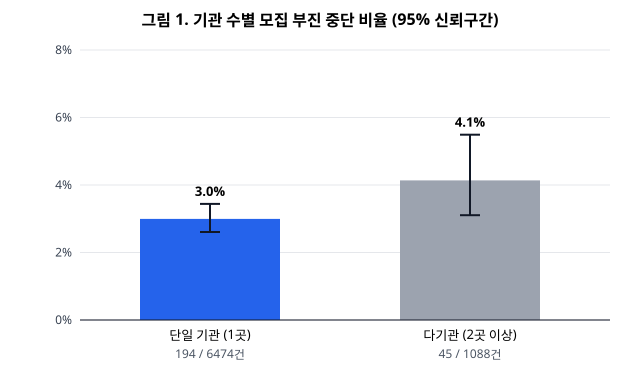

# 연구 기관이 하나뿐인 재활·작업치료 임상시험은 모집 부진으로 더 자주 중단되는가?

### ClinicalTrials.gov 등록 시험 7,562건의 단면 분석

- 작성자: 임혜진 (ALEPH K-뉴딜 아카데미 대전 C반)
- 작성일: 2026-11-24
- 과제: T10 · AI 협업 연구 논문 작성과 가설 검증
- 자료: ClinicalTrials.gov API v2, 데이터 기준 시각 2026-11-20 10:00:05, 수집 2026-11-23

---

## 초록

**목적.** 연구 기관이 1곳인 재활·작업치료 중재 임상시험이 2곳 이상인 시험보다 "모집 부진"으로 중단되는 비율이 높은지 확인한다.
**방법.** ClinicalTrials.gov에서 2005–2022년에 시작해 완료 또는 중단된 재활·작업치료 중재 시험 8,105건을 받아, 연구 기관이 등록된 7,562건을 분석했다. 기관 수(1곳 / 2곳 이상)에 따라 중단 사유에 모집 부진이 적힌 시험의 비율을 비교했다(위험비, Fisher 정확 검정). 가설과 판정 기준은 데이터를 받기 전에 고정했다.
**결과.** 모집 부진 중단은 단일 기관 시험 194/6,474건(3.00%), 다기관 시험 45/1,088건(4.14%)이었다(위험비 0.72, 95% CI 0.53–1.00, p = 0.049). 단일 기관 쪽이 더 낮아 **가설은 지지되지 않았다.** 후원 기관 유형으로 보정한 위험비는 0.76(0.55–1.07)이었고, COVID-19가 사유로 적힌 시험을 빼면 차이가 뚜렷하지 않았다(0.85, 0.59–1.22).
**결론.** 이 자료에서는 기관이 하나뿐인 재활 시험이 모집 부진으로 더 자주 중단된다는 근거를 찾지 못했다.

---

## 1. 서론

### 1-1. 연구 배경

임상시험이 목표한 참여자를 모으지 못하면 중간에 멈추거나, 끝나더라도 처음 세운 연구 질문에 답하지 못한다. 그동안 참여한 사람의 시간과 연구비는 결과로 남지 못한다. 나는 재활의학과에서 연구코디네이터로 2년간 일하며 연구에 참여할 환자를 모집했고, 한 기관 안에서 조건에 맞는 환자를 찾는 일이 가장 어려웠다. 이 경험에서 "기관이 하나뿐이면 만날 수 있는 환자가 처음부터 적어서 모집에 실패하기 쉽지 않을까"라는 질문을 세웠다.

### 1-2. 선행 연구에서 확인된 사실

아래 내용은 각 문헌의 초록 원문에서 직접 확인한 것이다(확인 방법은 부록 A).

- 2000–2003년 윤리위원회에 제출된 무작위 시험 1,017건 가운데 253건(24.9%)이 중단되었고, 가장 흔한 사유는 모집 부진(101건, 9.9%)이었다. 산업체 후원(8.4% 대 26.5%)과 큰 계획 표본은 모집 부진 중단이 적은 것과 관련이 있었다 [1].
- ClinicalTrials.gov 결과 데이터베이스의 중단 시험 905건 가운데, 시험 데이터와 무관한 이유로 중단된 619건에서 가장 흔한 사유는 모집 속도 부족(350건, 57%)이었다 [2].
- 2011년에 종료된 2·3상 중재 시험 2,579건 중 481건(19%)이 모집 실패로 중단되었거나 목표의 85% 미만으로 끝났다. 비산업체 후원, 이른 단계, 그리고 **연구 기관 수가 적은 것**이 모집 실패와 관련이 있었다 [3].
- 모집 부진으로 중단된 무작위 시험 172건에서 가장 자주 보고된 원인은 대상자 유병률의 과대 추정과, 모집자·참여자가 중재에 대해 가진 선입견이었다 [4].
- 모집을 늘리는 전략을 평가한 시험 68건을 모은 고찰에서, 확실성이 높은 근거가 있는 비교는 72개 중 3개뿐이었다 [5].
- 2005–2015년 뇌졸중 재활 무작위 시험 512건에서 선별된 사람의 약 3분의 1(중앙값 34%)이 참여에 동의했고, 기관당 한 달에 평균 1.5명을 모집했다 [6].
- 급성기 재활 무작위 시험에서 환자를 모집한 치료사 18명을 조사한 연구에서, 치료사가 일한 기관은 모집률에 영향을 주지 않았고, 대학원 과정 이수 여부와 환자 예후에 대한 우려가 모집률과 관련이 있었다 [7].
- ClinicalTrials.gov 자료를 묶어 분석할 때는 자료 구조·용어·수집 방식이 시기에 따라 바뀐 점을 고려해야 한다 [8].

### 1-3. 이번 연구가 주장하려는 것과 가설

선행 연구 [3]은 약물 위주의 2·3상 시험에서 기관 수와 모집 실패의 관련성을 보였다. 재활·작업치료 시험은 대부분 비약물·학계 주도이고 단일 기관에서 진행되는 경우가 많아, 같은 관계가 나타나는지는 확인되지 않았다. 이번 연구는 이 관계를 **재활·작업치료 시험에서 다시 확인**하려 한다.

> **가설.** 재활·작업치료 중재를 다루는 종료된 중재 임상시험 가운데, 등록된 연구 기관이 1곳인 시험은 2곳 이상인 시험보다 "모집 부진"을 사유로 중단된 비율이 높다.

가설을 반증하는 결과는 "단일 기관의 비율이 다기관보다 같거나 낮음" 또는 "위험비의 95% 신뢰구간이 1을 포함함"으로 미리 정했다.

## 2. 방법

### 2-1. 연구 설계와 사전 고정

등록 자료를 이용한 단면 분석이다. 관심 분야, 검토한 후보 주제 10개, 제외한 주제와 사유, 가설, 측정 방법, 판정 기준, 보조 분석을 `01_가설과_분석계획.md`에 적고, **원자료를 받기 전에** 파일 지문(SHA-256)을 남겨 고정했다. 고정 뒤 달라진 점은 `02_설계변경_기록.md`에 모두 적었다.

### 2-2. 자료원과 대상

- 자료원: ClinicalTrials.gov API v2 (미국 국립의학도서관), 2026-11-23 수집, 데이터 기준 시각 2026-11-20
- 검색 조건: 중재 항목 검색 `"occupational therapy" OR rehabilitation`, 연구 유형 중재(INTERVENTIONAL), 상태 완료(COMPLETED) 또는 중단(TERMINATED), 시작일 2005-01-01 ~ 2022-12-31
- 조건에 맞는 시험 **전체**를 받았다(8,105건, API가 알려 준 건수와 일치).
- 제외: 연구 기관이 하나도 등록되지 않아 기관 수를 알 수 없는 시험 543건
- 분석 대상: **7,562건** (완료 7,023건, 중단 539건)

### 2-3. 실험·분석 설계

| 구분 | 내용 |
| --- | --- |
| 비교 조건 (독립변수) | 등록된 연구 기관 수: 단일 기관(1곳) / 다기관(2곳 이상). 기관은 시설명·도시·국가 조합으로 중복 없이 셌다 |
| 고정 조건 | 중재 시험, 완료 또는 중단 상태, 시작일 2005–2022, 같은 검색어, 같은 수집 시점, 같은 분류 규칙 |
| 표본 수 | 7,562건 (단일 기관 6,474건, 다기관 1,088건) |
| 측정 변수 (종속변수) | 모집 부진 중단 여부(1/0): 상태가 중단이고 중단 사유(whyStopped)에 미리 정한 낱말 규칙(recruit, enrol, accru, lack of participants 등)이 맞으면 1 |
| 기록 방법 | API 응답 원문을 `data/raw/`에 페이지별 JSON으로 저장, 시험별 정리표를 `data/trials_main.csv`로 저장 |
| 주 분석 | 2×2 표, 비율 차이, 위험비(로그 방법 95% CI), Fisher 정확 검정(양측, 유의수준 0.05) |
| 보조 분석 (사전 계획) | 1) 후원 유형(산업체/그 밖)으로 나눠 보기와 Mantel–Haenszel 보정 위험비 2) 시작 시기(2005–2013/2014–2022) 3) 작업치료만 4) 중단 시험 안에서의 사유 비율 5) 분류 규칙 점검(무작위 40건) |
| 탐색적 점검 (결과를 본 뒤 추가) | E1) 규칙에 "inclusion" 추가 E2) COVID-19 사유 제외 E3) 사유와 상관없는 전체 중단 E4) 완료 시험의 등록 인원 비교 |

예비 실행으로 검색 조건별 전체 건수만 확인해, 작업치료만으로는 중단 시험이 66건뿐이어서 판정이 어렵다는 것을 알고 범위를 재활까지 넓혔다. 이때 기관 수나 사유별 수치는 보지 않았다.

### 2-4. 도구

Python 3 표준 라이브러리만 썼다(외부 패키지 없음). 수집은 `scripts/fetch_ctgov.py`, 분석·표·그림은 `scripts/analyze.py`가 만든다.

## 3. 결과

### 3-1. 분석 대상

**표 1. 분석 대상의 흐름**

| 항목 | 건수 |
| --- | --- |
| 내려받은 시험 | 8,105 |
| 제외: 연구 기관이 등록되지 않음 | 543 |
| 분석한 시험 | 7,562 |
| 완료 | 7,023 |
| 중단 (사유 없음 30건 포함) | 539 |
| 그중 모집 부진 중단 | 239 |
| 단일 기관 / 다기관 | 6,474 / 1,088 |

단일 기관 시험이 전체의 85.6%였다. 산업체가 주 후원자인 시험은 단일 기관에서 1.90%, 다기관에서 8.36%였다.

### 3-2. 주 분석

**표 2. 기관 수별 모집 부진 중단 비율**

| 분석 | 단일 기관 | 다기관 | 비율 차이 | 위험비 (95% CI) | Fisher p |
| --- | --- | --- | --- | --- | --- |
| **주 분석: 전체** | 194/6,474 (3.00%) | 45/1,088 (4.14%) | −1.14%p | **0.72 (0.53–1.00)** | **0.049** |
| 보조 1: 산업체 후원 | 4/123 (3.25%) | 10/91 (10.99%) | −7.74%p | 0.30 (0.10–0.91) | 0.028 |
| 보조 1: 산업체 외 후원 | 190/6,351 (2.99%) | 35/997 (3.51%) | −0.52%p | 0.85 (0.60–1.21) | 0.374 |
| 보조 2: 시작 2005–2013 | 55/1,606 (3.42%) | 12/351 (3.42%) | 0.01%p | 1.00 (0.54–1.85) | 1.000 |
| 보조 2: 시작 2014–2022 | 139/4,868 (2.86%) | 33/737 (4.48%) | −1.62%p | 0.64 (0.44–0.92) | 0.022 |
| 보조 3: 작업치료만 | 20/432 (4.63%) | 4/85 (4.71%) | −0.08%p | 0.98 (0.34–2.81) | 1.000 |
| 보조 4: 중단 시험 안에서 | 194/441 (43.99%) | 45/98 (45.92%) | −1.93%p | 0.96 (0.75–1.22) | 0.737 |

- 주 분석의 비율 95% 신뢰구간: 단일 기관 2.61–3.44%, 다기관 3.11–5.49%
- 비율 차이 95% 신뢰구간: −2.39%p ~ 0.11%p
- 위험비 95% 신뢰구간의 상한은 0.996으로 1보다 조금 작다.
- 후원 유형으로 보정한 Mantel–Haenszel 위험비: 0.76 (0.55–1.07)

**그림 1.** 기관 수별 모집 부진 중단 비율과 95% 신뢰구간(Wilson 방법). `results/figure1_low_accrual_by_sites.svg`

### 3-3. 가설과 일치하는 결과와 일치하지 않는 결과

| 구분 | 결과 | 근거 값 |
| --- | --- | --- |
| 일치하지 않음 (주 분석) | 단일 기관의 모집 부진 중단 비율이 다기관보다 **낮았다** | 3.00% 대 4.14%, 위험비 0.72 |
| 일치하지 않음 | 사전에 정한 지지 조건(위험비 하한 > 1, p < 0.05)을 만족하지 않았다 | 위험비 95% CI 0.53–1.00 |
| 일치하지 않음 (보조 1) | 산업체 후원 시험에서 다기관이 더 높았다 | 3.25% 대 10.99% |
| 일치하지 않음 (보조 2) | 2014–2022년에 시작한 시험에서 다기관이 더 높았다 | 2.86% 대 4.48% |
| 차이 없음 (보조 1·2·3·4) | 산업체 외 후원, 2005–2013년 시작, 작업치료만, 중단 시험 안에서는 두 집단이 비슷했다 | 위험비 0.85, 1.00, 0.98, 0.96 (모두 신뢰구간이 1을 포함) |
| 일치하는 결과 | 없음. 어느 분석에서도 단일 기관이 통계적으로 더 높게 나오지 않았다 | — |

**판단.** 미리 정한 기준에 따라 이 데이터는 가설을 **지지하지 않는다.** 주 분석의 방향은 가설과 반대였다. 다만 위험비 신뢰구간의 상한이 0.996, p가 0.049로 경계에 있고, 후원 유형으로 보정하면 1을 포함하므로(0.55–1.07), "다기관 시험이 모집 부진으로 더 자주 중단된다"고 반대 방향의 결론을 내리지도 않는다.

### 3-4. 결과를 본 뒤 추가한 탐색적 점검

아래는 가설 검증에 쓰지 않는 탐색적 결과다.

**표 3. 탐색적 점검**

| 점검 | 단일 기관 | 다기관 | 위험비 (95% CI) | Fisher p |
| --- | --- | --- | --- | --- |
| E1: 분류 규칙에 "inclusion" 추가 | 208/6,474 (3.21%) | 52/1,088 (4.78%) | 0.67 (0.50–0.90) | 0.012 |
| E2: COVID-19 사유 79건 제외 | 174/6,414 (2.71%) | 34/1,069 (3.18%) | 0.85 (0.59–1.22) | 0.367 |
| E3: 사유와 상관없는 전체 중단 | 441/6,474 (6.81%) | 98/1,088 (9.01%) | 0.76 (0.61–0.93) | 0.011 |

- E4: 완료된 시험의 실제 등록 인원 중앙값은 단일 기관 45명, 다기관 78명이었다.
- E5: 중단 시험 가운데 무작위 40건의 사유 문장을 읽고 판정한 결과, 규칙 분류와 37건(92.5%)이 일치했다. 1건은 잘못 포함("enrolled"가 등록 인원을 말한 경우), 2건은 놓침("lack of inclusions", "difficulty of inclusion")이었다(`results/keyword_check_judged.csv`).

## 4. 논의

### 4-1. 결과의 해석

재활·작업치료 시험 7,562건에서, 기관이 하나뿐인 시험이 모집 부진으로 더 자주 중단된다는 근거는 나오지 않았다. 오히려 다기관 시험의 비율이 조금 높았지만, 그 차이는 경계에 있고 후원 유형을 고려하거나 COVID-19 사유를 빼면 뚜렷하지 않았다. 이는 2·3상 시험에서 기관이 적을수록 모집 실패가 많았던 선행 연구 [3]과 다른 결과다.

### 4-2. 가설과 다른 결과가 나온 원인 후보

1. **시험 규모의 차이.** 다기관 시험은 완료된 경우에도 등록 인원 중앙값이 더 컸다(78명 대 45명, E4). 단일 기관 재활 시험에는 목표 인원이 작은 예비 연구가 많을 수 있고, 목표가 작으면 모집 실패로 중단될 가능성도 작다. 다만 이번 자료에서 계획 목표 인원은 따로 확인하지 못했다(완료 시험은 실제 인원으로 바뀌어 있음).
2. **COVID-19의 영향.** 사유에 COVID-19가 적힌 시험을 빼자 다기관의 모집 부진 중단이 45건에서 34건으로 줄고 두 집단의 차이가 사라졌다(E2). 여러 기관이 함께 움직여야 하는 시험이 감염병 유행기에 더 쉽게 멈췄을 가능성이 있다. 2014–2022년에 시작한 시험에서만 차이가 보인 것(보조 2)도 이 설명과 어긋나지 않는다.
3. **다기관 시험의 전반적인 중단 경향.** 사유와 상관없이 중단 비율 자체가 다기관에서 높았고(9.01% 대 6.81%, E3), 중단된 시험 안에서 모집 부진이 차지하는 비율은 두 집단이 비슷했다(43.99% 대 45.92%, 보조 4). 즉 다기관 시험은 모집 문제가 특별히 많다기보다, 여러 이유로 더 자주 중단되는 것으로 보인다.
4. **후원 유형.** 산업체 후원은 다기관에 많았고(8.36% 대 1.90%), 산업체 후원 다기관 시험의 모집 부진 중단이 높았다(10.99%). 다만 해당 시험이 214건뿐이라 이 차이는 불확실하다.
5. **기관 수 측정의 한계.** 등록 기관 목록은 시험이 끝날 때 기준이고, 실제 운영 기관 수와 다를 수 있다. 등록된 기관이 없는 543건은 분석에서 빠졌다.

위 원인 후보 1–4는 같은 자료로 결과를 본 뒤 확인한 것이므로 **탐색적 가설**이다. 검증하려면 계획 목표 인원이 남아 있는 별도 자료(예: 등록 이력)나 다른 기간의 자료가 필요하다.

### 4-3. 연구의 한계

- **측정.** 모집 부진은 중단 사유 문장의 낱말 규칙으로 판정했다. 점검 표본 40건에서 3건이 어긋났고, 특히 "inclusion" 같은 표현을 놓쳤다. 이를 더한 넓은 규칙(E1)에서도 방향은 같았다.
- **결과 정의.** 끝까지 완료했지만 목표 인원에 못 미친 시험은 "모집 부진"으로 세지 않았다. 선행 연구 [3]은 이런 시험도 모집 실패에 포함했으므로 두 연구의 수치를 직접 비교할 수 없다.
- **대상.** 검색어 "rehabilitation"은 심장·호흡·약물 재활 등 넓은 시험을 포함한다. 작업치료만 본 분석(517건)은 중단 건수가 적어 차이를 판정하기 어려웠다.
- **관측 자료.** 등록 자료를 이용한 단면 분석이므로 인과 관계를 말할 수 없다. 시험 규모, 후원, 국가, 질환 같은 다른 요인을 모두 보정하지 않았다.
- **분석 시점.** 등록 내용은 계속 갱신된다. 이 논문의 수치는 제출 패키지에 들어 있는 2026-11-23 수집 원자료를 기준으로 한다.
- **분류 점검.** 사유 문장 40건을 읽고 판정한 것은 AI(Claude)이고, 판정 근거를 표에 남겼다.

### 4-4. 결론

2005–2022년에 시작한 재활·작업치료 중재 임상시험 7,562건에서, 연구 기관이 하나뿐인 시험이 모집 부진으로 더 자주 중단된다는 가설은 지지되지 않았다. 단일 기관 시험의 모집 부진 중단 비율은 3.00%로 다기관 4.14%보다 낮았고, 이 차이는 경계 수준이며 후원 유형을 보정하거나 COVID-19 사유를 빼면 뚜렷하지 않았다. 이 자료가 뒷받침하는 범위에서 말할 수 있는 것은 "등록된 기관 수만으로는 재활 시험의 모집 부진 중단을 설명하기 어렵다"는 것이다. 연구코디네이터로서 내가 겪은 "한 기관에서 환자를 찾기 어렵다"는 경험은, 시험이 중단되는 비율보다는 모집 속도나 목표 달성률 같은 다른 지표에서 확인해야 할 질문으로 남는다.

---

## 참고문헌

1. Kasenda B, von Elm E, You J, Blümle A, Tomonaga Y, Saccilotto R, et al. Prevalence, characteristics, and publication of discontinued randomized trials. JAMA. 2014;311(10):1045-51. doi:10.1001/jama.2014.1361. PMID: 24618966.
2. Williams RJ, Tse T, DiPiazza K, Zarin DA. Terminated trials in the ClinicalTrials.gov results database: evaluation of availability of primary outcome data and reasons for termination. PLoS One. 2015;10(5):e0127242. doi:10.1371/journal.pone.0127242. PMID: 26011295.
3. Carlisle B, Kimmelman J, Ramsay T, MacKinnon N. Unsuccessful trial accrual and human subjects protections: an empirical analysis of recently closed trials. Clin Trials. 2015;12(1):77-83. doi:10.1177/1740774514558307. PMID: 25475878.
4. Briel M, Olu KK, von Elm E, Kasenda B, Alturki R, Agarwal A, et al. A systematic review of discontinued trials suggested that most reasons for recruitment failure were preventable. J Clin Epidemiol. 2016;80:8-15. doi:10.1016/j.jclinepi.2016.07.016. PMID: 27498376.
5. Treweek S, Pitkethly M, Cook J, Fraser C, Mitchell E, Sullivan F, et al. Strategies to improve recruitment to randomised trials. Cochrane Database Syst Rev. 2018;2(2):MR000013. doi:10.1002/14651858.MR000013.pub6. PMID: 29468635.
6. McGill K, Sackley CM, Godwin J, McGarry J, Brady MC. A systematic review of the efficiency of recruitment to stroke rehabilitation randomised controlled trials. Trials. 2020;21(1):68. doi:10.1186/s13063-019-3991-2. PMID: 31924252.
7. Lannin N, Cusick A. Factors affecting patient recruitment in an acute rehabilitation randomized controlled trial. Am J Occup Ther. 2006;60(2):177-81. doi:10.5014/ajot.60.2.177. PMID: 16596921.
8. Tasneem A, Aberle L, Ananth H, Chakraborty S, Chiswell K, McCourt BJ, et al. The database for aggregate analysis of ClinicalTrials.gov (AACT) and subsequent regrouping by clinical specialty. PLoS One. 2012;7(3):e33677. doi:10.1371/journal.pone.0033677. PMID: 22438982.

자료원: U.S. National Library of Medicine. ClinicalTrials.gov API v2 [Internet]. https://clinicaltrials.gov/api/v2/studies (접근일 2026-11-23; 데이터 기준 2026-11-20).

---

## 부록 A. 선행 연구 확인 방법과 각 문헌이 뒷받침하는 부분

**확인 방법.** AI(Claude)가 먼저 관련 문헌 후보를 제시했다. PubMed 웹페이지는 자동 접근이 막혀 있어, 미국 국립생물정보센터(NCBI)가 자동 조회용으로 제공하는 E-utilities(esummary·efetch)로 각 문헌의 제목·저자·학술지·연도·권호·쪽·DOI·PMID와 초록 원문을 받았다. 받은 초록 원문은 `references/abstracts_pubmed_efetch.txt`, `references/abstracts_rehab_efetch.txt`에 그대로 보관했다. 본문 1-2절의 수치는 모두 이 초록에서 옮겼고, 본문 전문(full text)은 읽지 않았다.

| # | 문헌 | 실재 확인 | 이 연구의 어느 부분을 뒷받침하나 | 근거 종류 |
| --- | --- | --- | --- | --- |
| 1 | Kasenda 2014 | 예 | 모집 부진이 가장 흔한 중단 사유이고, 산업체 후원이 관련 요인이라는 점 → 보조 분석 1(후원 유형) 설계 | 시험 1,017건 코호트 데이터 |
| 2 | Williams 2015 | 예 | ClinicalTrials.gov 중단 사유 자료에서 모집 부족이 주된 사유라는 점 → 자료원과 결과 변수 선택 | 등록 자료 905건 분석 |
| 3 | Carlisle 2015 | 예 | 기관 수가 적을수록 모집 실패와 관련 → 가설 방향의 직접 근거 | 등록 자료 2,579건 분석 |
| 4 | Briel 2016 | 예 | 모집 실패의 원인이 대상자 수 과대 추정 등 계획 단계에 있다는 점 → 논의 4-2 | 체계적 문헌고찰(시험 172건) |
| 5 | Treweek 2018 | 예 | 모집 전략의 근거가 아직 약하다는 점 → 연구 배경 | 코크란 체계적 문헌고찰 |
| 6 | McGill 2020 | 예 | 재활 시험의 기관당 모집 속도 → 재활 분야의 모집 어려움 배경 | 체계적 문헌고찰(시험 512건) |
| 7 | Lannin 2006 | 예 | 작업치료 시험에서 기관보다 모집자 요인이 모집률과 관련 → 기관 수 외 요인에 대한 논의 | 치료사 18명 설문 |
| 8 | Tasneem 2012 | 예 | ClinicalTrials.gov 자료를 묶어 분석할 때의 주의점 → 한계 | 데이터베이스 구축·검증 연구 |

**제외한 문헌.** 실재하지 않거나 인용 내용이 달라 제외한 문헌은 없다. 다만 AI가 처음 제시한 1번 문헌의 제목("Discontinuation of randomized clinical trials")이 실제 제목과 달라, PubMed 기록에 따라 바로잡았다.

## 부록 B. 재현 방법

자세한 절차는 `README.md`에 있다. 요약하면 다음과 같다.

1. Python 3.9 이상을 준비한다(외부 패키지 없음).
2. 제출한 원자료로 결과를 다시 만들려면 `python scripts/analyze.py` 를 실행한다. `results/tables.md`의 수치가 이 논문의 표 1–3과 같으면 재현된 것이다.
3. 원자료를 새로 받으려면 `python scripts/fetch_ctgov.py` 와 `python scripts/fetch_ctgov.py --ot-only` 를 먼저 실행한다. 등록 내용이 계속 갱신되므로 새로 받은 자료의 수치는 조금 다를 수 있다.

## 부록 C. AI와 나의 판단

- **AI에게 맡긴 일:** 관심 분야(재활 임상시험 모집)에 맞는 후보 주제 10개와 데이터 출처 제안, 가설 문장·측정 방법·판정 기준·분석 계획 초안 작성, 선행 문헌 후보 제시와 PubMed 공식 조회로 실재 확인, 수집·분석 스크립트 작성과 실행, 중단 사유 40건 분류 점검, 탐색적 점검, 논문 초안 작성을 맡겼다. 범위를 작업치료에서 재활까지 넓히는 것, 가설 방향(단일 기관이 더 높다), 낱말 규칙도 AI가 제안해 진행했다.
- **내가 직접 판단한 일:** AI가 낸 후보 가운데 연구코디네이터로 환자 모집을 했던 내 경험과 이어지는 "임상시험 모집 부진"을 주제로 골랐다. 가설의 출발점인 "한 기관에서 환자를 찾기가 가장 어려웠다"는 경험은 내 것이다.
- **AI 말을 안 들은 일:** 없다. 이번에는 주제를 고른 뒤 설계와 분석을 AI에게 맡겼고, AI의 제안을 되돌린 일이 없었다. 가설과 판정 기준은 데이터를 받기 전에 고정되어 있었으므로, 결과가 가설과 반대로 나왔을 때도 가설이나 기준을 바꾸지 않고 그대로 실었다.
